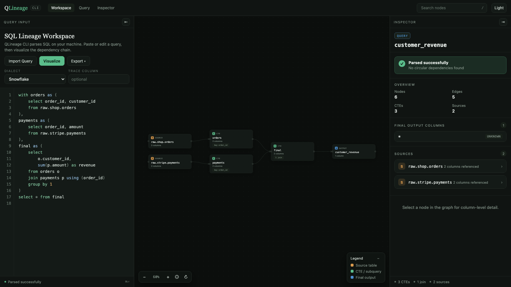
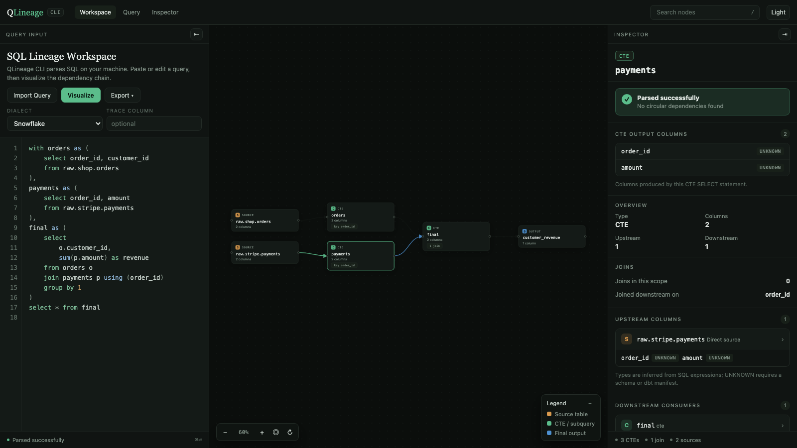
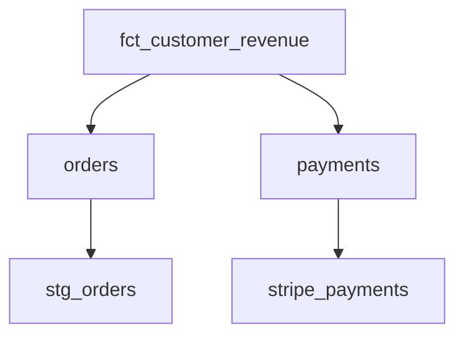

# QLineage CLI

**Local SQL + dbt lineage for Snowflake and Redshift. No warehouse connection required.**

QLineage CLI answers a simple question while you are working locally:

> What feeds this SQL model, and how does the query get there?

It parses SQL locally with SQLGlot and can use dbt's `target/manifest.json` + compiled SQL when available. The package installs as `qlineage-cli` and the command is `qlineage`.

## Install

Once published to PyPI:

```bash
uv tool install qlineage-cli
```

or:

```bash
pipx install qlineage-cli
```

For development / GitHub installs:

```bash
uv tool install git+https://github.com/MarkPhamm/qlineage_cli.git
```

## Quick start

```bash
qlineage models/marts/fct_orders.sql --dialect snowflake
```

That parses the SQL and opens the workspace in your browser, backed by a local server on `127.0.0.1` so you can keep editing the query and press **Visualize** to rebuild the graph. Press `Ctrl-C` in the terminal to stop it.



Select any node to inspect its columns, types, joins, and SQL:



To print a tree in the terminal instead:

```bash
qlineage models/marts/fct_orders.sql --format tree
```

```text
fct_customer_revenue
├── orders
│   └── ref:stg_orders
└── payments
    └── source:stripe.payments
```

Raw SQL works too:

```bash
qlineage query.sql --dialect redshift
```

## dbt-aware mode

If a `target/manifest.json` exists in the project, QLineage CLI auto-discovers it.

When the SQL file matches a dbt model, it prefers the model's compiled SQL and maps physical relations back to friendly dbt names where possible.

```bash
dbt compile
qlineage models/marts/fct_customer_revenue.sql
```

With a manifest and no SQL file, `qlineage --model` opens that model's neighborhood: what it refs, and what refs it. The canvas stays on that model instead of drawing the whole project. Click a model to load its compiled SQL and switch to the CTE graph. `--depth` caps the hops.

```bash
qlineage --model fct_customer_revenue
qlineage --select '+fct_customer_revenue'    # upstream only
qlineage --select 'fct_customer_revenue+'    # downstream only
qlineage --select 'fct_customer_revenue+1'   # one downstream hop
qlineage --select '+fct_customer_revenue+'   # both directions
```

`--dbt-graph` stays the upstream walk it was before:

```bash
qlineage models/marts/fct_customer_revenue.sql --dbt-graph
qlineage --model fct_customer_revenue --dbt-graph
```

## Column lineage

```bash
qlineage models/marts/fct_customer_revenue.sql --column revenue
```

Column lineage uses SQLGlot's lineage engine. It is strongest when dbt compiled SQL is available and columns are explicitly selected.

## Export

JSON:

```bash
qlineage query.sql --format json
```

Mermaid. In a terminal this writes a markdown file with the diagram in a `mermaid` code fence, named after the model (`dim_customers.lineage.md`), so it can be committed and rendered on GitHub. Use `--output` to choose the path, or pipe the command to get raw mermaid on stdout.

```bash
qlineage models/marts/marketing/dim_customers.sql --format mermaid
qlineage query.sql --format mermaid --output docs/lineage.md
qlineage query.sql --format mermaid > lineage.mmd
```

`--output` works for every format, so `--format json --output lineage.json` writes a file instead of printing.

HTML is the default output. Piping or `--no-open` writes a self-contained static snapshot instead of starting the workspace server; the snapshot renders the same page but cannot re-analyze edited SQL. From inside the workspace you can also export the graph as SVG, PNG, or JSON.

```bash
qlineage query.sql
qlineage query.sql --no-open > lineage.html
qlineage query.sql --port 9000
```

Example:



## Local workspace

Passing a SQL file opens the workspace with that query loaded. To start from a blank page instead:

```bash
qlineage ui
qlineage ui --port 8765 --dialect snowflake --no-open
```

Either way, parsing happens in Python on localhost; nothing is sent to a warehouse.

**Query panel.** Paste or import SQL with syntax highlighting and line numbers, pick a dialect, optionally name a column to trace, then choose Visualize. Editing the query and visualizing again rebuilds the graph in place.

The output node is named after the file or dbt model you opened, but only while the query still matches that file. Once you edit it, the name comes from the SQL itself: the target of a `create table ... as` or `insert into`, or `final output` for a plain `SELECT`.

**Canvas.** Drag nodes to rearrange them, drag the background to pan, and zoom with the controls or `Cmd`/`Ctrl` + scroll. Each node card shows its kind, name, column count, and either its join count or the key it is joined on downstream.

**Inspector.** Selecting a node shows parse status, its output columns with inferred types, an overview of upstream and downstream counts, join details, the exact columns consumed from each upstream relation, downstream consumers, and the SQL that produced that node.

**Layout.** Drag either panel edge to resize it, double-click an edge to reset it, or use the header tabs and the arrow buttons to hide a panel entirely. The theme toggle switches between dark and light.

### Keyboard shortcuts

| Shortcut | Action |
| --- | --- |
| `Cmd`/`Ctrl` + `Enter` | Visualize the current query |
| `/` | Focus the node search box |
| `Enter` in search | Select the first matching node |
| `Esc` | Clear the selection and close menus |

## Command reference

```text
qlineage [SQL_FILE] [options]
qlineage ui [options]
```

### `qlineage [SQL_FILE]`

| Option | Default | Description |
| --- | --- | --- |
| `--dialect snowflake\|redshift` | `snowflake` | SQL dialect used for parsing |
| `--format html\|tree\|json\|mermaid` | `html` | `html` opens the workspace; `mermaid` writes a markdown file; `tree`/`json` print to the terminal |
| `--output PATH`, `-o PATH` | none | Write the rendered lineage to a file instead of stdout |
| `--column COLUMN` | none | Trace a single output column through the query |
| `--model MODEL` | none | dbt model name or unique id. Without a SQL file, opens that model's neighborhood |
| `--select SELECTOR` | none | One model: `+model`, `model+`, `model+N`, `+model+`. Refuses a whole-project graph |
| `--manifest PATH` | auto-discovered | Path to a dbt `target/manifest.json` |
| `--dbt-graph` | off | Upstream dbt dependencies, instead of the neighborhood or CTE graph |
| `--depth N` | unlimited | Maximum hops for `--dbt-graph` and `--select` |
| `--no-dbt` | off | Skip dbt manifest auto-discovery |
| `--no-open` | off | Write a static HTML snapshot to stdout instead of serving |
| `--port N` | `8765` | Workspace port; falls back to a free port if taken |
| `--version` | | Print the installed qlineage version and exit |

### `qlineage ui`

| Option | Default | Description |
| --- | --- | --- |
| `--port N` | `8765` | Port to listen on |
| `--dialect snowflake\|redshift` | `snowflake` | Default dialect in the page |
| `--no-open` | off | Start the server without opening a browser |
| `--version` | | Print the installed qlineage version and exit |

## Why local-first?

- no Snowflake credentials
- no Redshift credentials
- no SQL sent to a hosted service
- useful inside an editor, terminal, CI job, or PR workflow
- dbt metadata is already available locally after compile/build

## Current scope

### Supported

- Snowflake SQL
- Redshift SQL
- CTE/table-level lineage
- dbt `ref()` / `source()` fallback parsing
- uncompiled model Jinja: `config`, ``/`` tags, comments, `this`, and common `dbt_utils` macros (`group_by`, `generate_surrogate_key`, `star`)
- dbt `manifest.json` auto-discovery
- compiled dbt SQL when available
- recursive dbt model/source lineage, including downstream of one model (`--model`, `--select`)
- single-output-column lineage
- per-node output columns with types inferred from SQL expressions
- join detection and join keys per node
- terminal, JSON, Mermaid, and HTML output
- local browser workspace with resizable panes, a highlighted SQL editor, and a column inspector
- SVG, PNG, and JSON export from the workspace

### Not yet

- schema-aware `SELECT *` expansion from a live warehouse
- macros that require executing arbitrary Jinja when no compiled SQL exists
- semantic layer / exposures / metrics

Those are good candidates for later releases.

## Development

```bash
git clone https://github.com/MarkPhamm/qlineage_cli.git
cd qlineage_cli
python -m venv .venv
source .venv/bin/activate
pip install -e '.[dev]'
pytest
ruff check .
```

Try the included example:

```bash
qlineage examples/sql/customer_revenue.sql --dialect snowflake
qlineage examples/dbt/models/fct_customer_revenue.sql --dialect snowflake
qlineage ui --no-open
```

## Release to PyPI

The repository includes a Trusted Publishing GitHub Actions workflow. After creating the `qlineage-cli` project on PyPI and configuring GitHub as a trusted publisher, publishing a GitHub Release will build and publish the package.

Screenshots in this README live in `docs/` and are regenerated from `examples/sql/customer_revenue.sql`.

## License

MIT
