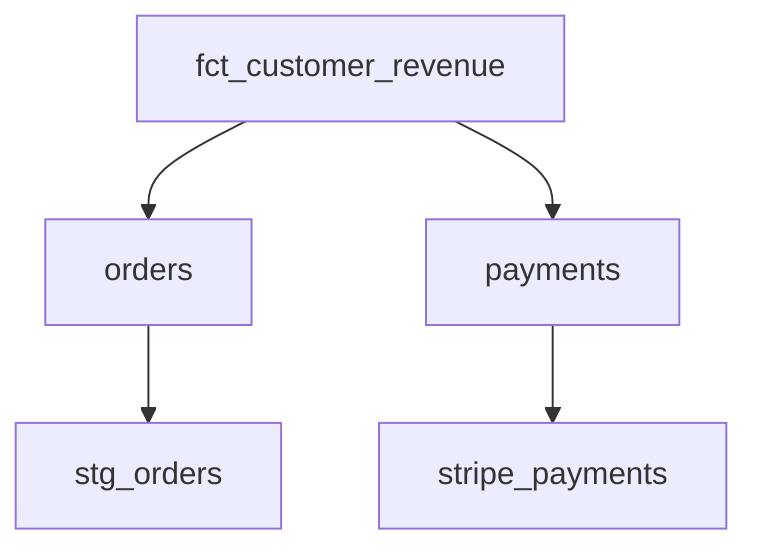

# qlineage-cli

**Local SQL + dbt lineage for Snowflake and Redshift. No warehouse connection required.**

`qlineage` answers a simple question while you are working locally:

> What feeds this SQL model, and how does the query get there?

It parses SQL locally with SQLGlot and can use dbt's `target/manifest.json` + compiled SQL when available.

## Install

Once published to PyPI:

```bash
uv tool install qlineage-cli
```

or:

```bash
pipx install qlineage-cli
```

For development / GitHub installs:

```bash
uv tool install git+https://github.com/MarkPhamm/qlineage_cli.git
```

## Quick start

```bash
qlineage models/marts/fct_orders.sql --dialect snowflake
```

Example output:

```text
fct_customer_revenue
├── orders
│   └── ref:stg_orders
└── payments
    └── source:stripe.payments
```

Raw SQL works too:

```bash
qlineage query.sql --dialect redshift
```

## dbt-aware mode

If a `target/manifest.json` exists in the project, qlineage auto-discovers it.

When the SQL file matches a dbt model, qlineage prefers the model's compiled SQL and maps physical relations back to friendly dbt names where possible.

```bash
dbt compile
qlineage models/marts/fct_customer_revenue.sql
```

To show the recursive dbt DAG instead of the internal SQL/CTE graph:

```bash
qlineage models/marts/fct_customer_revenue.sql --dbt-graph
```

or select a model directly:

```bash
qlineage --model fct_customer_revenue --dbt-graph
```

## Column lineage

```bash
qlineage models/marts/fct_customer_revenue.sql --column revenue
```

Column lineage uses SQLGlot's lineage engine. It is strongest when dbt compiled SQL is available and columns are explicitly selected.

## Export

JSON:

```bash
qlineage query.sql --format json
```

Mermaid:

```bash
qlineage query.sql --format mermaid
```

Example:



## Commands

```text
qlineage SQL_FILE
    [--dialect snowflake|redshift]
    [--manifest target/manifest.json]
    [--model MODEL]
    [--format tree|json|mermaid]
    [--column COLUMN]
    [--dbt-graph]
    [--depth N]
    [--no-dbt]
```

## Why local-first?

- no Snowflake credentials
- no Redshift credentials
- no SQL sent to a hosted service
- useful inside an editor, terminal, CI job, or PR workflow
- dbt metadata is already available locally after compile/build

## Current scope

### Supported

- Snowflake SQL
- Redshift SQL
- CTE/table-level lineage
- dbt `ref()` / `source()` fallback parsing
- dbt `manifest.json` auto-discovery
- compiled dbt SQL when available
- recursive dbt model/source lineage
- single-output-column lineage
- terminal, JSON, and Mermaid output

### Not yet

- interactive browser graph
- schema-aware `SELECT *` expansion from a live warehouse
- macros that require executing arbitrary Jinja when no compiled SQL exists
- semantic layer / exposures / metrics

Those are good candidates for later releases.

## Development

```bash
git clone https://github.com/MarkPhamm/qlineage_cli.git
cd qlineage_cli
python -m venv .venv
source .venv/bin/activate
pip install -e '.[dev]'
pytest
ruff check .
```

Try the included example:

```bash
qlineage examples/sql/customer_revenue.sql --dialect snowflake
qlineage examples/dbt/models/fct_customer_revenue.sql --dialect snowflake
```

## Release to PyPI

The repository includes a Trusted Publishing GitHub Actions workflow. After creating the `qlineage-cli` project on PyPI and configuring GitHub as a trusted publisher, publishing a GitHub Release will build and publish the package.

## License

MIT
